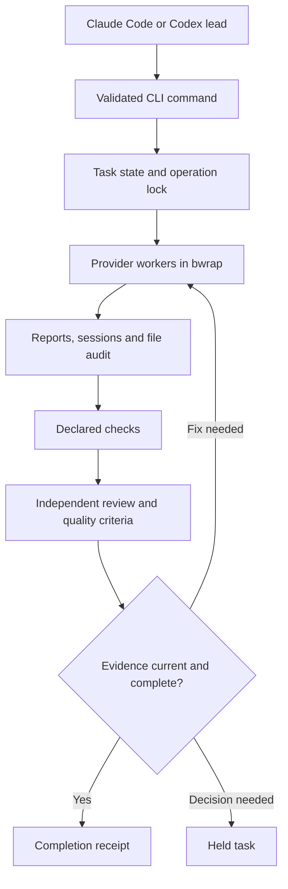

# Architecture

This describes the refactored implementation delivered as 0.14.0. The product is a local process supervisor
and evidence-based workflow, not a new model runtime. Claude Code and Codex still own model inference and
provider protocol semantics.

## Boundaries

| Layer | Source | Responsibility |
|---|---|---|
| Command contract | `cmd/agentgate/args.go`, `help.go` | One registry of commands, flags, input sources and help; no actions while parsing help |
| Command dispatch | `cmd/agentgate/commands.go`, `design_tools.go` | Translate validated inputs into operations, serialize output, delegate standalone design commands |
| Domain and state | `internal/dev/types.go`, `state.go`, `lifecycle.go` | Task identity, phases, persistence, corruption checks and interrupted-round recovery |
| Task execution | `writers.go`, `arch.go`, `scout.go`, `stages.go`, `run.go` | Bounded workers, dependency waves, continuation and stage handoffs |
| Evidence | `snapshots.go`, `checks.go`, `check_receipts.go`, `review.go`, `quality.go` | File snapshots, input fingerprints, check receipts, independent reviews and acceptance rules |
| Worktrees | `internal/dev/worktree.go` | Isolated checkout, preparation, scope audit, catch-up and guarded landing |
| Terminal UI | `panel_state.go`, `panel_model.go`, `panel_render.go`, `term.go`, `terminal_text.go` | Read-only dashboard data, navigation, rendering and terminal protocol |
| Provider adapters | `internal/provider/claude.go`, `codex.go`, `events.go` | CLI arguments, streamed events, structured results and resume identifiers |
| Provider execution | `sandbox.go`, `credentials.go`, `environment.go`, `routing.go`, `run.go` | Mount policy, private authentication snapshots, account/model routing and process results |
| Accounts | `internal/accounts/manager.go`, `limits.go`, `probe.go`, `codex_rpc.go` | Quota observations, cooldowns, bounded RPC lifecycle and account ranking |
| Configuration | `internal/config/load.go`, `validation.go`, `storage.go`, `profiles.go`, `extensions.go` | Layer precedence, structural validation, validated atomic edits and profile selection |
| Process and file primitives | `internal/ops/process.go`, `atomic.go`, `ops.go` | Cancellation, process identity, reaping, operation receipts and durable JSON replacement |
| Design toolkit | `design-kit/lib`, `design-kit/bin`, `design-kit/embed.go` | Figma transports, atomic packages, layout comparison, fixtures and stand ownership |
| Distribution | `internal/update`, `scripts`, `Makefile` | Checksummed atomic updates, offline install and source-plus-binary packaging |

The Go packages have no third-party dependencies. The terminal UI uses explicit state/update/render
separation without adding a framework dependency. Node and Playwright are optional for design work; basic
planning, writing, checking and text review do not depend on a browser.

## Data flow

Every operation is a normal process. A session lock prevents two commands from mutating the same task
simultaneously; a checkout scope lock serializes file ownership claims between sessions. State lives in the
user state directory, separate from worker-writable code. No daemon needs to remain healthy between calls.

## Lifecycle and recovery

The main writing cycle is `implementing → awaiting-review → reviewed → complete`. A correction uses
`correcting → awaiting-review`. Staged work also has an accepted-stage boundary and may enter a final
integration review. `held` remembers the prior phase; `cancelled` is terminal.

A phase label alone is insufficient. Review requires each scheduled stream of the current writer round to
have a completed record. Completion requires the current content and contract to match the review and all
required checks/evidence. Corrupt JSON or inconsistent state is reported; it cannot be treated as an empty
checkout with no active task.

An interrupted operation becomes an explicit hold. `resume` acknowledges the hold; `continue` retries the
saved round's unfinished streams while preserving completed reports, sessions and the baseline. A blocked
writer requires an answer rather than a blind retry. A user stop is never automatically reversed.

Cancellation waits for process reaping before consumers read exit status. Process receipts include Linux
start identity so an old PID cannot identify an unrelated new process. Atomic state writes sync the file,
rename it and sync its parent directory. A failed persistence operation is returned to the caller.

## Evidence and invalidation

| Evidence | Bound to | Invalidated by |
|---|---|---|
| Code review | Declared owned files, context, task contract and relevant quality/design evidence | Changed scoped bytes, plan or required proof |
| Check with explicit `inputs` | Its command, declared patterns and matched contents | Input content/set changes, command changes or inability to fingerprint inputs |
| Check without `inputs` | Repository working content and HEAD | Repository changes or HEAD changes |
| Design package | Actual manifest and inventoried file bytes | Missing/corrupt inventory, changed spec/assets/images/brief |
| Design baseline | Design content, page/root, viewport, device, map and tolerances | Any contract change or a different discrepancy |
| Writer ownership | Assigned paths plus recorded attempts | Foreign changes, path escapes or incomplete streams |

Review freshness is scoped. An agent can read additional files outside declared context; those reads do
not automatically become dependencies. Declare meaningful context/check inputs and use an isolated
worktree when a stable task snapshot matters. Binding every review to every unrelated repository edit
would invalidate concurrent sessions unnecessarily, so it is not the default.

A pre-existing failing check remains a failing check. Baseline receipts explain history, but do not prove
that a later failure is the same defect. Layout baselines are narrower: an exact discrepancy under an
unchanged measurement contract can be recorded, and changed discrepancies still fail.

## Provider independence and account identity

Actual model identities of every writer attempt are retained, including partial failures, fallback attempts
and earlier stages. Reviewer routing excludes all of them. A different alias or another account of the same
model is not independent authorship. The mixed-provider defaults reserve Fable and Astra for review while
Opus writes substantial tasks; the Codex-only profile uses separate models in one provider.

Quota fallback is allowed only on a structured failure classified as a limit, never on successful prose.
The actual route, account, session and lane directory travel together. A continued session is not silently
moved to another model. The receipts expose substitutions and observed model/vendor diversity.

Credential files are copied to a private lane so provider CLIs can atomically refresh them. The parent
compares the original profile with the snapshot before writeback. Conflicting refreshes or a concurrent
login preserve the host profile and surface a conflict. This is narrower than making the user's entire
CLI profile writable inside a worker.

## Design subsystem

Figma REST and the browser scene-graph compatibility adapter both produce the same design package. The
REST adapter requests documented file/image endpoints and pins render requests to the loaded version.
It sends the token only to the API host. Browser access uses the user's own separate profile and checks
export permission; it is subject to Figma's private UI changes.

An export builds in a sibling temporary directory under an exclusive export lock. Only a complete package
with a verified inventory replaces the previous package. Failed renders/downloads leave the previous
package intact. The Go gate and Node checker both verify inventory integrity.

A layout run owns only the stand and fixture processes it starts. A healthy existing stand is reused and
left running; an unhealthy existing listener is reported. Owned processes get bounded readiness and
termination handling. `--keep` explicitly detaches a successfully started stand and prints process/log
information. The fixture server binds to loopback, rejects unsafe names and oversized requests, and does
not invent successful data for an unrecorded operation.

## Compatibility decisions

The flat command API remains available alongside `task` and `setup`. Existing valid configuration and
exported packages continue to work. Unknown flags, malformed values, incomplete packages and invalid state
that previously slipped through are now errors. Heavy/ultra frontend defaults changed to prevent a built-in
writer/reviewer collision. See [migration](migration.md) for behavior changes and recovery commands.
