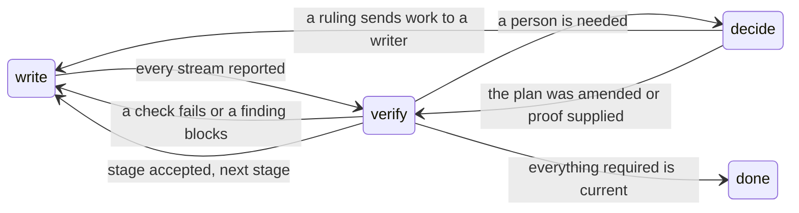

# How it works

[Русский](ru/how-it-works.md)

## The roles

| Role | Who | Can do |
|---|---|---|
| Lead | your Claude Code or Codex session | everything a normal session can: your MCP servers, plugins and skills stay available. Its pages — what each need asks, what each command answers — are installed as the skill `agentgate` |
| Preparation | one read-only model process, resumed on every call | read the repository, ask what only a person can decide, draft the plan and a map of the area |
| Architect | a fresh model process | heavy and ultra: read the repository, return a design |
| Writer | a model process per stream, resumed for corrections | edit the files of its stream |
| Reviewer | a model process that did not write the code, resumed for rechecks | read the patch, return findings and verdicts on the criteria |

`agentgate` is the only thing that starts workers. The lead never spawns agents for the task. It owns product
decisions, authorization and the report to the user; it is asked for decisions, not for keystrokes.

## One command moves the task

```
prepare ⇄ questions → [architecture] → start → run ⇄ (answer | decide | amend) → done
```

`agentgate run` takes every step the state determines and stops only where a person is needed. `start`
already runs; `answer` and `decide` run on by themselves.

| Step | What `run` does there |
|---|---|
| `write` | starts the pending streams of the round, wave by wave; a finished stream is never started again |
| `verify` | runs the declared checks, then the independent review, then reads the result |
| `decide` | nothing: something only a person can settle is listed in `needs` |
| `done` | the task is complete |

What follows a verification is determined, so the tool does it:

- **Clean** — the stage is accepted in the same run. The next stage opens, or the whole change is reviewed
  once more for the seams, or the task ends.
- **Fixable** — a failing check or a blocking finding goes back to the writers that own it, in their own
  sessions, and the loop continues without the lead.
- **Needs a person** — the task stops at `decide` with a typed list.

| `needs` | What happened |
|---|---|
| `answer` | a writer stopped with questions |
| `failed` | a writer or a provider failed; `run` retries the unfinished streams |
| `review` | the mode has no reviewer process (`review: []`): the lead is the reviewer and is handed the patch |
| `finding` | the author disputed a finding and the reviewer upheld it, or it waits for an approval |
| `requirement`, `rule` | a criterion that is due is not verified, and the cause is not code a writer can add: the proof is missing, or the plan put it where it cannot be met |
| `stall` | a correction made no verified progress: a new diagnosis is needed, not another attempt |
| `limit` | three corrections ran in a row without the lead looking |
| `setup` | a verification tool could not observe the result |
| `scenarios` | opted-in browser scenarios were not observed |
| `scope` | an isolated task changed a file that no stream owns |

Each need carries the call that settles it — `command` and `input`, with the real ids, streams and valid
references filled in — so the lead does not look the shape up. Every answer also lists `actions`: the
commands that are legal now, the one that moves the task first. A command that is not legal, or that fails,
answers with the same picture and the reason; its own data is under `result`. `status` adds what is running
and how the last command ended. The guard, the list and the tests
are derived from one table, so a task cannot reach a position with no way out
([decision 0002](decisions/0002-one-state-machine.md)).

A pause is not a step. It lies on top of the position: `user` (the user stopped the task; only `resume`, on
their word, lifts it), `decision` (the lead waits for the user) and `step` (confirm every stage). Any action
that moves the task lifts the last two.

### Findings are answered by their author

A finding at a severity the mode blocks on goes straight to the writer that owns the file. The writer checks
it against the code and its brief. It fixes it, or returns a dispute with evidence. The reviewer that raised
the finding reads the dispute in its own session and withdraws the finding or upholds it. Only an upheld
dispute reaches the lead, with both arguments. A finding is therefore closed by the reviewer's agreement or
by the lead's ruling, never by the author alone. Findings below the blocking line are notes
([decision 0005](decisions/0005-autopilot-and-author-filtered-findings.md)). A later pass is shown the open
notes, and a finding raised again at the same path and line joins the earlier one instead of becoming a new
one.

A requirement that is not verified carries the reviewer's cause. `code` — the code does not do it — goes to
the writer that owns that code, as a blocking finding does, and is closed when the requirement is verified.
`proof` and `plan` go to the lead. The lead decides three things only: it rules on findings, it judges a
patch where no reviewer process runs, and it gives work — `decide {work: [{stream, note, requirement?,
escalate?}]}` opens a correction for the named streams at any step after their round
([decision 0012](decisions/0012-the-lead-gives-work.md)).

Two things keep the loop cheap: a recheck runs only the lanes that have something to verify plus one
correctness lane on the delta, one effort step lower; and effort rises only when a correction demonstrably
stalled.

### When the plan is wrong

`agentgate amend` changes the plan of the active task at any step, with `update` saying what changed and
why: named operations — files for a stream, checks added or removed, a requirement added or moved, timeouts,
designs, the mode — or the complete plan. Accepted stages are frozen. A requirement may be added, or moved to the stage that completes it;
changing or removing one needs `authorized`. An amendment makes stale only what it touches: moving a
requirement has the reviewer reassess the criteria in its own session and does not re-read the code
([decision 0006](decisions/0006-amendment-is-ordinary.md)).

What is deliberately not there: a separate explorer before the writers (the preparation worker already read
the repository and hands over its map), a separate test-writing agent (tests belong to the stream that
changes the behaviour), a merge step (writers share one checkout with disjoint files), triage of every
finding by the lead, and a summary written by hand at the end (the writers' reports are the record).

## Where the plan lives

`agentgate prepare --file request.txt` — the request as the user typed it — delegates repository discovery
and plan preparation to a read-only worker. The plan is typed, so the provider enforces its shape; the tool validates all of it and returns every
problem at once to the same worker, which corrects its draft without exploring again. Answers to its
questions and the lead's notes continue the same session. The lead checks scope and authorizations. To save
an explicitly edited plan:

```sh
agentgate plan save wallet --file plan.json
```

The saved files are:

```
<repository>/.agentgate/plans/<name>/plan.json   what the tool runs
<repository>/.agentgate/plans/<name>/brief.md    the same plan for a person: brief, mode and why, streams with
                                                  their writers and files, checks, the accepted design
```

`route`, `architecture`, `start` and `amend` accept `--plan <name>` instead of a plan file. `plan save` can
also read another saved plan with `--plan <name>`. Other commands use their own input schemas; for example,
`decide --file decision.json` accepts the lead's decisions, not a plan. Saving again replaces the plan and its
brief. A plan is checked as a whole before anything starts: a plan that could not be finished — a stage with
no declared check and no stated waiver, a requirement no stage covers — is refused when it is saved.
The directory is yours to commit or to ignore; the gate does not count these notes as part of a change.

To have the same plans on every computer, keep the directory in a synced folder:

```sh
agentgate plan link ~/iCloud/agentgate    # once per repository and computer; the folder is remembered
```

This moves `.agentgate` to `<folder>/<repository name>/` and leaves a link in its place. On the second
computer the same command links the checkout to what is already there. `.agentgate/config.json` — your own
settings for this repository, read after the team's `.agentgate.json` — travels with it.

Design receipts and the context pack of a prepared plan belong to the checkout, not to one conversation
(`~/.local/state/agentgate/<checkout>/designs`, `…/packs`). A plan designed today can therefore be started
from a new session tomorrow without paying for the design again; a receipt stays bound to its brief, mode and
rules by a fingerprint.

## Keeping model-written code lean

Code written by a model tends to carry extras that look diligent and cost maintenance: comments that narrate
the code, checks for states that cannot happen, a wrapper around one call, a leftover `console.log`. Three
layers deal with it, cheapest first.

1. **The writer is told what not to add**, with the reason: every added line is read now and maintained later.
   Scope, comments, defensive code, abstractions, type escapes, leftovers and "results that are not real" each
   have a rule, and the writer reads its own diff as a reviewer before reporting.
2. **A scan of the added lines, before any reviewer runs.** It costs no model call. It looks only at lines the
   task added, in code files, for literal leftovers: placeholders, TODOs, debug output, disabled tests, type and
   lint suppressions, swallowed errors, comments that narrate the change, conflict markers. The hits are
   `slop_signals`: leads for the reviewers and the lead, never verdicts — the same text can be right.
3. **The `simplicity` axis of the review**, judged in the same process as the design, so it costs no extra
   lane. The reviewer asks of each added piece whether the task would be done, and the code just as safe,
   without it — and must prove it: quote the line and name the fact that makes it unneeded (its only caller,
   the type that rules the state out, the helper that already exists). The remedy is a deletion. Faked results
   and hidden failures are P1; code someone must keep for no benefit is P2. Naming and formatting taste, what a
   linter already reports and code the change did not add are out of scope.

In a mode configured without a reviewer process (`review: []`) the lead receives the signals with the patch
and applies the same test; light mode has a reviewer of its own by default. `/dev clean` remains the way to
simplify code that is already in the repository.

The rules draw on public work: the community `/deslop` commands and the `code-slop` skill for the list of
patterns, the Karpathy-inspired guidelines for "every changed line traces to the request", Anthropic's
prompting guidance on over-engineering, and PhotoStructure's review rule "prove it or discard it" for keeping
the axis from turning into a style campaign.

## The gate

A task is a *gate*: one JSON state file per lead session and checkout, under `~/.local/state/agentgate/`.



When the task opens, the tool records the whole working tree as a git tree — your uncommitted and untracked
work included — in a private object directory inside the task's state. Your index, objects and refs are never
written. It does the same at every stage boundary and review, so "what was here before" has an answer for any
file at any time, also for one that a generator adds later
([decision 0004](decisions/0004-evidence-on-git-trees.md)). From then on:

- A **review** is bound to the exact change of the stage's files, to the files it was pointed at and to the
  contract it judged. Edit a file, or change the brief, and the review no longer counts.
- A **check** result is bound to the files it declared as inputs, as git records them: what git ignores — a
  tool's cache under `node_modules`, a build output — is not an input unless a pattern points into it by its
  literal prefix (`dist/**`), and a link counts with what it leads to inside the repository. With no declared
  inputs it is bound to the whole tree it ran against, so an edited sibling dependency invalidates it. Checks run before reviewers; a
  failing check sends the task back to its writers without a review. A failure observed before the task is
  recorded for diagnosis; it does not waive the requirement for a passing check.
- **Findings** keep their ids across rounds. A defect that comes back reopens under the same id; it cannot be
  renamed away.
- A stage is accepted only when the review is current, every declared check has a current passing result, no
  blocking finding is open, every requirement that is due is verified and every required browser scenario
  was observed. A requirement is due at the last stage that covers it.

A Stop hook keeps the lead from ending its turn on an unfinished task, unless an operation is still running
or the task is honestly paused. Its message names a command that was just refused and the kinds of what the
task needs.

A finished task answers with a receipt — the routes that ran, substitutions, the checks and their results,
rounds and time per stage — and the notes it leaves, one line each. Accepting a note reopens the task where it
ended. `drop` ends a task on the user's word and takes back what it changed, never overwriting a file someone
else edited since; `forget` removes a finished or dropped task from the record.

Two sessions can work in the same checkout. Each has its own task; a file can be owned by only one of them.

## The sandbox

Every worker is started through `bwrap`:

- the whole host is mounted read-only;
- `/tmp` and `/run` are private and empty;
- the worker's own lane directory is writable (its logs, its session);
- a writer additionally gets the checkout writable, and the shared board;
- unrelated lead integrations are not automatically loaded; explicitly configured worker MCP tools and
  their declared writable directories are separate permissions.

An ordinary reviewer receives the checkout read-only. Writers can write the checkout, their lane, the
shared board and any explicitly granted extension directories. File ownership *between* writers is enforced
by assignment and audit, not by per-file mounts: the gate compares the working tree with the tree the stage
started from and reports changes outside the task's files. In an isolated worktree such a change is settled
before anything is reviewed, because what the worktree holds is what lands.

The host read-only mount still allows broad reads, and network access remains available for providers and
configured tools. AgentGate masks its lead-private browser directory, but this is not complete secrecy or
isolation from hostile code. Declared checks and extensions also have executable authority; see the
[security and trust model](../SECURITY.md) before choosing them.

The provider's own sandbox is switched off inside `bwrap`: nesting a second one fails on hardened kernels.

## How agents talk

Nobody "calls" anybody. Every channel is either a packet file or a continued session, so every exchange is on
disk and nothing depends on a daemon staying alive.

| Channel | From → to | Mechanism |
|---|---|---|
| Questions | preparation → lead → user | structured questions with options and a recommendation; the answers go back into the **same session**, which does not explore again |
| Context pack | preparation → writers, reviewers | one JSON map of the area: files and their roles, callers, invariants, conventions. Written by the worker that drafted the plan and named in every later packet |
| Assignment | tool → writer | one JSON packet: brief, the stream's files, context, the requirements it works on, the accepted design. Files are named, never copied |
| Report | writer → tool | fixed schema: status, summary, blockers, deviations, handoff, disputes |
| Handoff | writer → writer | the contract a stream actually implemented, delivered in the assignment of the streams that come `after` it and of the next stage |
| Board | writers ↔ writers, lead → writers | a shared directory; each writer posts its public contract as soon as it is decided, and reads the others' |
| Answer | lead → blocked writer | the reply is sent into the writer's **own session**; it continues with full context |
| Work | lead → writer | `decide {work}`: the lead's note goes to the named stream's writer in its **own session**, as a correction |
| Review packet | tool → reviewer | one patch of the change, the files as they were, the criteria. Generated output is listed, not shown |
| Findings | reviewer → writer | blocking findings go to the writer that owns the file, in its **own session** |
| Dispute | writer → reviewer | the author's evidence against a finding, answered by the reviewer in its **own session** |
| Failing checks | tool → writer | the command and the end of its output go back to the writers, in their **own sessions**, before any reviewer runs |
| Recheck | tool → reviewer | the reviewer that raised a finding verifies the fix in its **own session**, reading only the delta, one effort step lower; lanes with nothing to verify do not run |
| Cross-critique | architect ↔ architect | ultra only: each receives the other's design and looks for blockers |

The board is read at natural boundaries. It is a note, not an interrupt: a writer cannot preempt another.

### Why sessions are continued

Starting a fresh process means re-reading the repository. Continuing a session means sending one message. The
places where that matters are answers to the preparation worker, answers to writers, corrections and
rechecks, and those are exactly the ones that repeat. Independence is not lost: a reviewer is still a
different model from the writer, in a different process, and a first review is always a fresh context.

## Parallelism and pools

Each model alias belongs to a *pool* — the subscription or quota it draws from. Lanes that run at the same time
are routed to different pools by the mode table, so they do not compete for one limit:

```
heavy design     fable:high (pool fable)   ∥  astra:high (pool codex)
heavy writers    opus:high  (pool claude), one per stream
heavy review     fable:high (pool fable)   ∥  astra:high (pool codex)
```

With several subscriptions configured, each call first picks the account with the most room for its model,
and an exhausted account hands over to the next one on the same model ([accounts](accounts.md)).
When every account of a provider answers that its limit is exhausted, the lane is retried on the declared alternates in order.
Two rules are never broken: the model that wrote the code is not used to review it, and the substitution is
recorded and shown to the user.

## What is not here

- No shared task list that workers pull from, no long-lived worker panes. Workers are processes with one job.
- No per-writer worktrees. Writers of one task share a directory with disjoint files; nothing has to be merged
  between them. A whole task can be isolated in its own worktree with `-w` ([isolation](isolation.md)).
- No automatic commits, pushes or merges in your checkout. The lead reports; the user decides. An isolated
  task is committed on its own private branch and lands only on the user's word.
