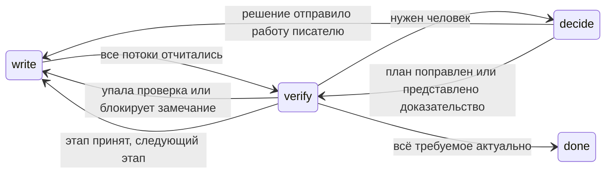

# Как это устроено

[English](../how-it-works.md)

## Роли

| Роль | Кто | Что может |
|---|---|---|
| Лид | ваша сессия Claude Code или Codex | всё, что обычная сессия: ваши MCP-серверы, плагины и скиллы остаются доступны. Его страницы — что просит каждая потребность, что отвечает каждая команда — установлены как скилл `agentgate` |
| Подготовка | один читающий процесс модели, возобновляемый при каждом вызове | читать репозиторий, спрашивать о том, что может решить только человек, составить план и карту области |
| Архитектор | свежий процесс модели | режимы с архитекторами (по умолчанию medium, heavy, ultra): читать репозиторий, вернуть дизайн |
| Писатель | процесс модели на поток, возобновляемый для исправлений | править файлы своего потока |
| Ревьюер | процесс модели, не писавшей код, возобновляемый для перепроверок | читать патч, вернуть замечания и вердикты по критериям |

Воркеров запускает только `agentgate`. Лид не порождает агентов для задачи сам. За ним продуктовые решения,
разрешения и отчёт пользователю; от него ждут решений, а не нажатий клавиш.

## Задачу двигает одна команда

```
prepare ⇄ вопросы → [architecture] → start → run ⇄ (answer | decide | amend) → done
```

`agentgate run` делает каждый шаг, который однозначно следует из состояния, и останавливается только там,
где нужен человек. `start` уже запускает работу; `answer` и `decide` продолжают её сами.

| Шаг | Что на нём делает `run` |
|---|---|
| `write` | запускает ожидающие потоки раунда, волна за волной; завершённый поток повторно не запускается |
| `verify` | выполняет объявленные проверки, затем независимое ревью, затем читает результат |
| `decide` | ничего: то, что может решить только человек, перечислено в `needs` |
| `done` | задача завершена |

Что следует из проверки, известно заранее, поэтому это делает инструмент:

- **Чисто** — этап принимается в том же запуске. Открывается следующий этап, либо всё изменение ещё раз
  читается целиком ради стыков, либо задача завершается.
- **Исправимо** — упавшая проверка или блокирующее замечание возвращается писателям, которым принадлежит
  код, в их собственные сессии, и цикл продолжается без лида.
- **Нужен человек** — задача останавливается на `decide` с типизированным списком.

| `needs` | Что произошло |
|---|---|
| `answer` | писатель остановился с вопросами |
| `failed` | писатель или провайдер завершился ошибкой; `run` повторяет незавершённые потоки |
| `review` | в режиме нет процесса-ревьюера (`review: []`): ревьюер — лид, ему передан патч |
| `finding` | автор оспорил замечание, а ревьюер его подтвердил; либо замечание ждёт согласования |
| `requirement`, `rule` | критерий, срок которого наступил, не подтверждён, и причина не в коде, который может дописать писатель: нет доказательства, или план поставил его туда, где его не выполнить |
| `stall` | исправление не дало подтверждённого продвижения: нужен новый диагноз, а не ещё одна попытка |
| `limit` | три исправления прошли подряд без участия лида |
| `setup` | инструмент проверки не смог наблюдать результат |
| `scenarios` | выбранные браузерные сценарии не просмотрены |
| `scope` | изолированная задача изменила файл, который не принадлежит ни одному потоку |

Каждая потребность несёт вызов, который её закрывает, — `command` и `input` с настоящими id, потоками и
допустимыми ссылками, — так что лиду не нужно искать форму. В каждом ответе есть и `actions`: команды,
допустимые сейчас; первая из них двигает задачу. Недопустимая или неудавшаяся команда отвечает той же
картиной и причиной; собственные данные команды лежат в `result`. `status` добавляет, что сейчас выполняется
и чем закончилась последняя команда. Проверка допустимости, этот список и тесты выводятся из одной
таблицы, поэтому задача не может оказаться в положении без выхода
([решение 0002](../decisions/0002-one-state-machine.md)).

Пауза — не шаг. Она лежит поверх положения: `user` (задачу остановил пользователь; снимает её только
`resume`, по его слову), `decision` (лид ждёт пользователя) и `step` (подтверждать каждый этап). Последние
две снимает любое действие, двигающее задачу.

### На замечания отвечает автор

Замечание с серьёзностью, которая в этом режиме блокирует, сразу уходит писателю, владеющему файлом.
Писатель сверяет его с кодом и своим брифом. Он либо исправляет, либо возвращает возражение с
доказательствами. Ревьюер, поднявший замечание, читает возражение в своей сессии и снимает замечание или
подтверждает его. До лида доходит только подтверждённый спор — с обоими аргументами. Поэтому замечание
закрывается согласием ревьюера или решением лида, но никогда одним автором. Замечания ниже блокирующей
планки — заметки ([решение 0005](../decisions/0005-autopilot-and-author-filtered-findings.md)). Следующий
проход видит открытые заметки, а замечание на той же строке того же файла присоединяется к прежнему, а не
становится новым.

Неподтверждённое требование несёт причину, названную ревьюером. `code` — код этого не делает — уходит
писателю, владеющему этим кодом, как блокирующее замечание, и закрывается, когда требование подтверждено.
`proof` и `plan` уходят лиду. Лид решает только три вещи: выносит решения по замечаниям, сам ревьюит патч
там, где нет процесса-ревьюера, и даёт работу — `decide {work: [{stream, note, requirement?, escalate?}]}`
открывает исправление для названных потоков на любом шаге после их раунда
([решение 0012](../decisions/0012-the-lead-gives-work.md)).

Цикл дешёв благодаря двум вещам: перепроверку выполняют только полосы, которым есть что проверять, плюс одна
полоса корректности по дельте, на ступень усилия ниже; а усилие растёт, только когда исправление доказуемо
застряло.

### Когда план неверен

`agentgate amend` меняет план активной задачи на любом шаге; в поле `update` сказано, что изменилось и
почему: именованные операции — файлы потоку, проверки добавить или убрать, требование добавить или
перенести, таймауты, дизайны, режим — или полный план. Принятые этапы заморожены. Требование можно добавить или перенести на этап, который его завершает;
изменить или убрать его можно только с `authorized`. Поправка делает устаревшим лишь то, что затрагивает:
при переносе требования ревьюер переоценивает критерии в своей сессии и не читает код заново
([решение 0006](../decisions/0006-amendment-is-ordinary.md)).

Чего здесь намеренно нет: отдельного разведчика перед писателями (воркер подготовки уже прочитал
репозиторий и передаёт свою карту), отдельного агента для написания тестов (тесты принадлежат потоку,
который меняет поведение), шага слияния (писатели делят один каталог с непересекающимися файлами), триажа
каждого замечания лидом и итога, написанного вручную в конце (записью служат отчёты писателей).

## Где живёт план

`agentgate prepare --file request.txt` — запрос в том виде, как его набрал пользователь, — поручает
читающему воркеру исследование и подготовку плана. План
типизирован, поэтому его форму обеспечивает провайдер; инструмент проверяет план целиком и возвращает все
проблемы сразу тому же воркеру, который исправляет черновик, не исследуя код заново. Ответы на его вопросы и
заметки лида продолжают ту же сессию. Лид проверяет продуктовые решения и разрешения. Явно
отредактированный план сохраняется так:

```sh
agentgate plan save wallet --file plan.json
```

Результат находится в файлах:

```
<репозиторий>/.agentgate/plans/<имя>/plan.json   то, что запускает инструмент
<репозиторий>/.agentgate/plans/<имя>/brief.md    тот же план для человека: бриф, режим и почему, потоки с
                                                  писателями и файлами, проверки, принятый дизайн
```

`route`, `architecture`, `start` и `amend` принимают `--plan <имя>` вместо файла плана. `plan save` тоже
может прочитать другой сохранённый план через `--plan <имя>`. У остальных команд свои схемы входа: например,
`decide --file decision.json` принимает решения лида, а не план. Повторное сохранение заменяет план и бриф.
План проверяется целиком до начала работы: план, который нельзя было бы завершить, — этап без объявленной
проверки и без объяснённого отказа от неё, требование, не покрытое ни одним этапом, — отклоняется при
сохранении.
Коммитить каталог или игнорировать — ваш выбор; гейт не считает эти заметки частью изменения.

Чтобы планы были одинаковыми на всех компьютерах, держите каталог в синхронизируемой папке:

```sh
agentgate plan link ~/iCloud/agentgate    # один раз на репозиторий и компьютер; папка запоминается
```

Команда переносит `.agentgate` в `<папка>/<имя репозитория>/` и оставляет на его месте ссылку. На втором
компьютере та же команда привязывает рабочий каталог к уже лежащим там данным. Вместе с планами переезжает
`.agentgate/config.json` — ваши личные настройки для этого репозитория, они читаются после командного
`.agentgate.json`.

Квитанции дизайна и контекстный пакет подготовленного плана принадлежат рабочему каталогу, а не одному
разговору (`~/.local/state/agentgate/<каталог>/designs`, `…/packs`). Поэтому план, спроектированный
сегодня, можно запустить завтра из новой сессии, не оплачивая дизайн повторно; квитанция остаётся привязанной
к брифу, режиму и правилам отпечатком.

## Как отсеивается лишнее в коде моделей

Код, написанный моделью, часто несёт лишнее, которое выглядит старательностью, а стоит сопровождения:
комментарии, пересказывающие код, проверки невозможных состояний, обёртка вокруг одного вызова, забытый
`console.log`. С этим работают три слоя, от самого дешёвого.

1. **Писателю сказано, чего не добавлять**, и объяснено почему: каждую добавленную строку сейчас читают, а
   потом сопровождают. Для объёма, комментариев, защитного кода, абстракций, обходов типов, остатков и
   «ненастоящих результатов» есть своё правило, а перед отчётом писатель читает собственный дифф как ревьюер.
2. **Скан добавленных строк до запуска ревьюеров.** Он не стоит ни одного вызова модели. Смотрятся только
   строки, добавленные задачей, и только в файлах с кодом: заглушки, TODO, отладочный вывод, отключённые
   тесты, подавления типов и линтера, проглоченные ошибки, комментарии о самой правке, маркеры конфликтов.
   Найденное — это `slop_signals`: наводки для ревьюеров и лида, а не приговоры — тот же текст может быть
   уместен.
3. **Ось ревью `simplicity`**, которая оценивается в том же процессе, что и дизайн, поэтому не требует
   отдельной полосы. Ревьюер спрашивает о каждом добавленном фрагменте, была бы задача выполнена, а код так
   же безопасен без него, — и обязан это доказать: процитировать строку и назвать факт, делающий её ненужной
   (единственный вызывающий; тип, исключающий состояние; уже существующий помощник). Способ исправления —
   удаление. Подделанные результаты и скрытые сбои — P1; код, который придётся сопровождать без пользы, — P2.
   Вкусовые претензии к именам и форматированию, то, что уже сообщает линтер, и код, не добавленный этим
   изменением, в ось не входят.

В режиме, настроенном без процесса-ревьюера (`review: []`), лид получает сигналы вместе с патчем и применяет
тот же тест; у режима light по умолчанию свой ревьюер. Для упрощения кода, который уже лежит в репозитории,
остаётся `/dev clean`.

Правила опираются на публичные работы: команды сообщества `/deslop` и навык `code-slop` — для перечня
признаков; правила в духе Карпати — «каждая изменённая строка прослеживается до запроса»; рекомендации
Anthropic о переусложнении; правило ревью PhotoStructure «докажи или отбрось» — чтобы ось не превращалась в
кампанию за стиль.

## Гейт

Задача — это *гейт*: один JSON-файл состояния на сессию лида и рабочий каталог, в `~/.local/state/agentgate/`.



При открытии задачи инструмент записывает всё рабочее дерево как git-дерево — вместе с вашими
незакоммиченными и неотслеживаемыми файлами — в приватный каталог объектов внутри состояния задачи. Ваш
индекс, объекты и ссылки не изменяются. То же делается на каждой границе этапа и при каждом ревью, поэтому
на вопрос «что здесь было раньше» есть ответ для любого файла в любой момент, в том числе для файла,
который генератор добавит позже ([решение 0004](../decisions/0004-evidence-on-git-trees.md)). Дальше:

- **Ревью** привязано к точному изменению файлов этапа, к файлам, на которые оно опиралось, и к контракту,
  который оценивало. Изменили файл или бриф — ревью больше не считается.
- Результат **проверки** привязан к объявленным входным файлам. Если входы не указаны, он привязан ко всему
  дереву, на котором проверка шла: правка соседней зависимости делает результат устаревшим. Проверки идут до
  ревьюеров; упавшая проверка возвращает задачу писателям без ревью. Сбой, существовавший до задачи,
  записывается для диагностики, но не отменяет требование успешной проверки.
- **Замечания** сохраняют идентификаторы между раундами. Вернувшийся дефект открывается под прежним id;
  переименовать его нельзя.
- Этап принимается, только когда ревью актуально, у каждой объявленной проверки есть актуальный успешный
  результат, нет открытых блокирующих замечаний, подтверждено каждое требование, срок которого наступил, и
  просмотрены все обязательные браузерные сценарии. Срок требования — последний этап, который его покрывает.

Stop-хук не даёт лиду закончить ход на незавершённой задаче, если только операция ещё не выполняется или
задача честно поставлена на паузу. Его сообщение называет только что отклонённую команду и виды того, что
нужно задаче.

Завершённая задача отвечает квитанцией — маршруты, которые работали, замены, проверки и их результаты,
раунды и время по этапам — и заметками, которые она оставляет, по строке на каждую. Принятая заметка снова
открывает задачу там, где она закончилась. `drop` по слову пользователя завершает задачу и возвращает то, что
она изменила, никогда не затирая файл, который с тех пор правил кто-то другой; `forget` убирает завершённую
или сброшенную задачу из записей.

В одном каталоге могут работать две сессии. У каждой своя задача; файл принадлежит только одной из них.

## Песочница

Каждый воркер запускается через `bwrap`:

- весь хост смонтирован только для чтения;
- `/tmp` и `/run` приватные и пустые;
- собственный каталог полосы доступен на запись (логи, сессия);
- писатель дополнительно получает на запись рабочий каталог и общую доску;
- посторонние интеграции лида автоматически не подключаются; явно настроенные MCP-инструменты воркеров и
  разрешённые им каталоги для записи задаются отдельно.

Обычный ревьюер получает рабочий каталог только для чтения. Писатель может менять рабочий каталог, каталог
своей сессии, общую доску и явно разрешённые каталоги расширений. Владение файлами *между* писателями
обеспечивается заданием и аудитом, а не монтированием каждого файла: гейт сравнивает рабочее дерево с
деревом, с которого начался этап, и сообщает об изменениях вне файлов задачи. В изолированном worktree
такое изменение разбирается до любого ревью: то, что лежит в worktree, и будет перенесено.

Доступный только для чтения хост всё ещё можно читать, а сеть остаётся доступной для провайдеров и
настроенных инструментов. AgentGate скрывает свой приватный каталог браузера лида, но не обеспечивает
полную конфиденциальность или изоляцию от враждебного кода. Команды проверок и расширения тоже выполняют код;
их полномочия описаны в [модели безопасности и доверия](../../SECURITY.md).

Собственная песочница провайдера внутри `bwrap` отключена: вложенная вторая не запускается на защищённых ядрах.

## Как агенты общаются

Никто никому не «звонит». Каждый канал — это либо файл-пакет, либо продолжение сессии, поэтому любой обмен
остаётся на диске и ничего не зависит от живого демона.

| Канал | От кого кому | Механизм |
|---|---|---|
| Вопросы | подготовка → лид → пользователь | структурированные вопросы с вариантами и рекомендацией; ответы уходят в **ту же сессию**, которая не исследует код заново |
| Контекстный пакет | подготовка → писатели, ревьюеры | одна JSON-карта области: файлы и их роли, вызывающие, инварианты, приёмы. Её пишет воркер, составивший план; она указывается в каждом последующем пакете |
| Задание | инструмент → писатель | один JSON-пакет: бриф, файлы потока, контекст, требования, над которыми поток работает, принятый дизайн. Файлы называются, а не копируются |
| Отчёт | писатель → инструмент | строгая схема: статус, итог, вопросы, отступления, передача, возражения |
| Передача | писатель → писатель | контракт, который поток реально реализовал; попадает в задание потоков, идущих `after` него, и следующего этапа |
| Доска | писатели ↔ писатели, лид → писатели | общий каталог; каждый публикует свой контракт, как только он решён, и читает чужие |
| Ответ | лид → заблокированный писатель | ответ уходит в **ту же сессию** писателя; он продолжает с полным контекстом |
| Работа | лид → писатель | `decide {work}`: заметка лида уходит писателю названного потока в **его же сессию**, как исправление |
| Пакет ревью | инструмент → ревьюер | один патч изменения, файлы в прежнем виде, критерии. Сгенерированный вывод перечислен, но не показан |
| Замечания | ревьюер → писатель | блокирующие замечания получает писатель, владеющий файлом, в **своей сессии** |
| Возражение | писатель → ревьюер | доказательства автора против замечания; ревьюер отвечает в **своей сессии** |
| Упавшие проверки | инструмент → писатель | команда и конец её вывода возвращаются писателям в **их сессии**, до запуска любого ревьюера |
| Перепроверка | инструмент → ревьюер | исправление проверяет ревьюер, поднявший замечание, в **своей сессии**, читая только дельту, на ступень усилия ниже; полосы, которым нечего проверять, не запускаются |
| Перекрёстная критика | архитектор ↔ архитектор | только ultra: каждый получает дизайн другого и ищет блокеры |

Доска читается на естественных границах работы. Это заметка, а не прерывание: писатель не может перебить соседа.

### Зачем продолжать сессии

Новый процесс заново читает репозиторий. Продолжение сессии — это одно сообщение. Важно это там, где работа
повторяется: ответы воркеру подготовки, ответы писателям, исправления и перепроверки. Независимость не
теряется: ревьюер остаётся другой моделью в другом процессе, а первое ревью всегда идёт в свежем контексте.

## Параллельность и бюджеты

Каждый псевдоним модели относится к *пулу* — подписке или квоте, из которой он расходуется. Полосы, работающие
одновременно, таблица режимов направляет в разные пулы, чтобы они не конкурировали за один лимит:

```
дизайн heavy     fable:high (пул fable)   ∥  astra:high (пул codex)
писатели heavy   opus:high  (пул claude), по одному на поток
ревью heavy      fable:high (пул fable)   ∥  astra:high (пул codex)
```

Когда настроено несколько подписок, каждый вызов сначала выбирает аккаунт с наибольшим запасом для своей
модели, а исчерпанный аккаунт передаёт работу следующему на той же модели ([аккаунты](accounts.md)).
Когда об исчерпанном лимите сообщили все аккаунты провайдера, полоса повторяется на объявленных заменах по порядку. Два
правила не нарушаются никогда: модель, написавшая код, его не ревьюит, а замена записывается и показывается.

## Чего здесь нет

- Нет общего списка задач, из которого воркеры берут работу, и нет долгоживущих панелей воркеров.
- Нет отдельных worktree на писателя. Писатели одной задачи делят каталог, работая с непересекающимися
  файлами. Целую задачу можно изолировать в собственном worktree флагом `-w` ([изоляция](isolation.md)).
- Нет автоматических коммитов, пушей и слияний в вашей директории. Лид отчитывается, решает пользователь.
  Изолированная задача коммитится в собственную служебную ветку и вливается только по слову пользователя.
